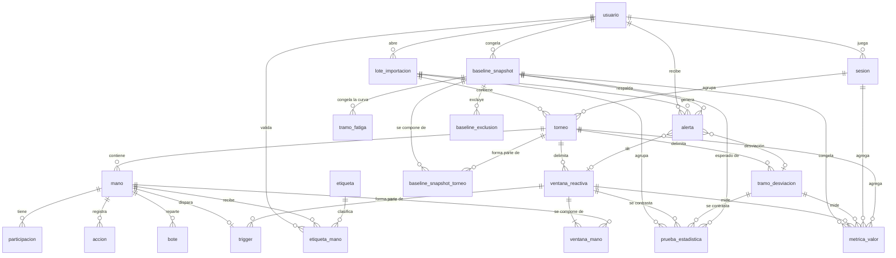

# 02 — Modelo de datos

> **Documento interno.** No forma parte de la entrega. Desarrolla en detalle las 16 entidades de `7.1.5 Requisitos de almacenamiento de información` y añade las cuatro que el modelo necesita. La memoria oficial solo resume las entidades; este documento fija campos, tipos, claves, relaciones e invariantes.

**Proyecto:** Mindset & EV Leak Finder  
**Autor:** Mario Ramírez García  
**Versión:** 0.13  
**Fecha:** 17 de noviembre de 2026

---

## 1. Alcance

- Modelo **lógico relacional** del MVP: tablas, campos, tipos, claves primarias y foráneas, nulabilidad e invariantes.
- Agnóstico de motor. Los tipos son orientativos y compatibles con PostgreSQL.
- Cubre las 14 entidades originales de 7.1.5 más siete nuevas: `trigger`, `prueba_estadistica`, `bote`, `metrica_valor`, `baseline_exclusion`, `baseline_snapshot_torneo` y `ventana_mano`.
- `trigger` y `prueba_estadistica` ya forman parte de 7.1.5 como `RI-15` y `RI-16`. `bote`, `metrica_valor`, `baseline_exclusion`, `baseline_snapshot_torneo` y `ventana_mano` son detalles de implementación y se quedan en este documento.
- No cubre interfaz, autenticación externa, contenido del glosario ni la implementación física (índices, particiones, DDL).

## 2. Convenciones

| Convención | Regla |
|---|---|
| Identificador | `UUID` v4 como clave primaria sustituta en todas las tablas |
| Claves naturales | Se conservan `hand_id`, `id_externo` de torneo y `numero_original` de mano |
| Importes | `NUMERIC(12,4)` en ciegas grandes |
| Fichas | `INTEGER` solo para ante, SB, BB y nivel |
| Fechas | `TIMESTAMPTZ` en UTC; la interfaz las muestra en hora local |
| Enumerados | `TEXT` con `CHECK`, no tipos nativos del motor |
| Nombres | `snake_case` en español |
| Datos económicos | Prohibidos buy-in, fee, bounty y rake |
| Texto visible | Ninguno: se guardan códigos y datos en bruto; el texto se compone en el frontend desde el archivo de traducción (M01) |
| Inmutabilidad | Manos y snapshots de baseline no se actualizan tras insertarse |
| Reproducibilidad | Todo cálculo guarda la versión del algoritmo que lo produjo |
| Datos derivados | Sesiones y métricas agregadas se recalculan; no son fuente de verdad. Los tramos de fatiga se calculan al crear el baseline y se congelan con él (M09) |
| Multiusuario | Todas las tablas de datos llevan `usuario_id` o lo heredan por su padre |

## 3. Vista general

## 4. Entidades

### 4.1 `usuario` — RI-01

Cuenta, preferencias y consentimiento del jugador.

| Campo | Tipo | Nulo | Clave | Descripción |
|---|---|---|---|---|
| `id` | UUID | No | PK | Identificador |
| `nombre` | TEXT | No | UQ | Nombre visible |
| `email` | TEXT | No | UQ | Correo de acceso |
| `hash_contrasena` | TEXT | No | | Hash de la contraseña |
| `sal_contrasena` | TEXT | No | | Sal del hash |
| `sitio_activo` | TEXT | No | | `Winamax` en el MVP |
| `formato_activo` | TEXT | No | | `MTT` en el MVP |
| `nivel_juego` | TEXT | No | | Código del tramo de buy-in en el que suele jugar sus MTT: `micro`, `bajo`, `medio`, `alto` o `muy_alto`. Lo declara el jugador al registrarse y puede cambiarlo desde el drawer. Los nombres y rangos que ve el jugador (Micro 1–5 €, Bajo 5–10 €, Medio 10–25 €, Alto 25–50 € y Muy alto 50 € o más) viven en el archivo de traducción (M01), no en la base de datos. Son rangos de nivel que declara el jugador, no una clasificación de torneos: no se especifican fronteras |
| `ventana_reactiva` | INTEGER | No | | Manos de la ventana T+30; por defecto 30 |
| `fdr_q` | NUMERIC(4,3) | No | | Umbral FDR; por defecto 0,05 |
| `consentimiento_nivel2` | BOOLEAN | No | | Autoriza el etiquetado colaborativo |
| `consentimiento_fecha` | TIMESTAMPTZ | Sí | | Fecha del consentimiento |
| `creado_en` | TIMESTAMPTZ | No | | Alta de la cuenta |

Restricciones: `ventana_reactiva IN (20, 30, 50, 100)`, `fdr_q IN (0.100, 0.050, 0.010)` (M19), `nivel_juego IN ('micro', 'bajo', 'medio', 'alto', 'muy_alto')`.

`nivel_juego` es un dato declarado por el jugador: no se deriva de ningún torneo ni contradice la invariante 16, porque el buy-in de los torneos no se guarda. Solo sirve para ponderar sus etiquetas del Nivel 2.

### 4.2 `lote_importacion` — RI-12

Conjunto de torneos incorporados en una operación atómica.

| Campo | Tipo | Nulo | Clave | Descripción |
|---|---|---|---|---|
| `id` | UUID | No | PK | Identificador |
| `usuario_id` | UUID | No | FK | Propietario |
| `tipo` | TEXT | No | | `baseline` o `auditoria` |
| `fecha_utc` | TIMESTAMPTZ | No | | Momento de la carga |
| `torneos` | INTEGER | No | | Torneos procesados |
| `manos` | INTEGER | No | | Manos procesadas |
| `sesiones_lote` | INTEGER | No | | Sesiones calculadas en aislamiento |
| `periodo_desde` | TIMESTAMPTZ | No | | Primera mano del lote |
| `periodo_hasta` | TIMESTAMPTZ | No | | Última mano del lote |
| `ventana_reactiva` | INTEGER | Sí | | Manos de la ventana T+30 configuradas al importar; nulo en los lotes `baseline` (M11) |
| `fdr_q` | NUMERIC(4,3) | Sí | | Umbral FDR configurado al importar; nulo en los lotes `baseline` (M11) |
| `creado_en` | TIMESTAMPTZ | No | | Alta del registro |

El lote solo existe si el procesamiento termina. Un fallo no deja lote ni torneos.

Restricciones: `tipo IN ('baseline', 'auditoria')`, `ventana_reactiva > 0`, `0 < fdr_q < 1`, y ambos campos no nulos si y solo si `tipo = 'auditoria'`.

**Configuración aplicada (M11).** `ventana_reactiva` y `fdr_q` copian los valores de `usuario` en el momento de importar, igual que `baseline_snapshot` los copia al congelarse. Así el umbral con el que se decidió `prueba_estadistica.significativa` sigue siendo auditable aunque el jugador cambie después la sensibilidad, y un lote sin triggers conserva igualmente la ventana con la que se analizó. Un cambio de configuración afecta solo al siguiente lote.

Un lote de tipo `baseline` es el que sube el jugador desde Mi Baseline. Se procesa igual que uno de auditoría, pero solo construye el perfil: no genera alertas ni pruebas estadísticas y sus torneos no aparecen en el Historial ni en los visores. El Dashboard y el Historial consideran únicamente los lotes de tipo `auditoria`.

### 4.3 `sesion` — RI-03

Bloque continuo de manos separadas por pausas no superiores a 30 minutos.

| Campo | Tipo | Nulo | Clave | Descripción |
|---|---|---|---|---|
| `id` | UUID | No | PK | Identificador |
| `usuario_id` | UUID | No | FK | Propietario |
| `inicio` | TIMESTAMPTZ | No | | Primera mano |
| `fin` | TIMESTAMPTZ | No | | Última mano |
| `duracion_min` | INTEGER | No | | Minutos entre inicio y fin |
| `manos` | INTEGER | No | | Manos de la sesión |
| `torneos` | INTEGER | No | | Torneos de la sesión |
| `sitio` | TEXT | No | | Sitio de las manos |
| `formato` | TEXT | No | | Formato de las manos |
| `resultado_bb` | NUMERIC(12,4) | No | | Suma de `net_bb` |
| `ev_bb` | NUMERIC(12,4) | No | | Suma de `ev_bb` |
| `bb100` | NUMERIC(10,4) | No | | 100 × resultado / manos |
| `evbb100` | NUMERIC(10,4) | No | | 100 × EV / manos |
| `recalculada_en` | TIMESTAMPTZ | No | | Última reconstrucción |

Restricciones: `fin >= inicio`, `duracion_min >= 0`, `UNIQUE (usuario_id, inicio)`.

La sesión es **derivada y recalculable**: al importar un lote se reconstruyen las sesiones afectadas y pueden fusionarse. Ninguna alerta referencia una sesión. La clave natural `(usuario_id, inicio)` es la que se conserva entre reconstrucciones; el `id` puede cambiar y `torneo.sesion_id` se actualiza en consecuencia.

### 4.4 `torneo` — RI-02

Unidad de competición que agrupa manos.

| Campo | Tipo | Nulo | Clave | Descripción |
|---|---|---|---|---|
| `id` | UUID | No | PK | Identificador |
| `usuario_id` | UUID | No | FK | Propietario |
| `lote_id` | UUID | No | FK | Lote que lo incorporó |
| `sesion_id` | UUID | No | FK | Sesión a la que pertenece |
| `id_externo` | TEXT | No | UQ | Identificador del nombre del archivo |
| `nombre` | TEXT | No | | Nombre del torneo |
| `sitio` | TEXT | No | | `Winamax` |
| `formato` | TEXT | No | | `MTT` |
| `fecha_inicio` | TIMESTAMPTZ | No | | Primera mano |
| `fecha_fin` | TIMESTAMPTZ | No | | Última mano |
| `nivel_inicial` | INTEGER | No | | Nivel de la primera mano |
| `nivel_final` | INTEGER | No | | Nivel de la última mano |
| `max_jugadores` | INTEGER | No | | Máximo de jugadores en mesa (formato de mesa: 3, 6...), leído de la línea `Table` del archivo (M17) |
| `recompensa` | TEXT | No | | `ninguna`, `ko` o `mystery` (M17) |
| `manos` | INTEGER | No | | Manos del torneo |
| `bb_ganadas` | NUMERIC(12,4) | No | | Suma de `mano.net_bb` («BB ganadas») |
| `ev_bb` | NUMERIC(12,4) | No | | Suma de `mano.ev_bb` («All-in EV») |
| `sigma_suerte_bb` | NUMERIC(12,4) | No | | Suerte esperable por azar en los all-in, en BB (σ) |
| `suerte_allin` | TEXT | No | | `a_favor`, `neutra` o `en_contra` |
| `nombre_archivo` | TEXT | No | | Archivo de origen |
| `hash_archivo` | TEXT | No | | SHA-256 del archivo |
| `parser_version` | TEXT | No | | Versión del parser |
| `creado_en` | TIMESTAMPTZ | No | | Alta del registro |

Restricciones: `UNIQUE (usuario_id, id_externo)`, `fecha_fin >= fecha_inicio`, `manos > 0`, `sigma_suerte_bb >= 0`, `suerte_allin IN ('a_favor', 'neutra', 'en_contra')`, `recompensa IN ('ninguna', 'ko', 'mystery')`.

**Formato de mesa y recompensa (M17).** El parser lee el tamaño de mesa de la línea `Table` (`6-max`, `3-max`) y deduce la recompensa: `ko` si las líneas de asiento llevan «bounty» y `mystery` si el nombre del torneo lo indica, porque en esos torneos los asientos no muestran bounty; el resto es `ninguna`. Solo se detectan: no se guardan importes ni se calcula un baseline por combinación. El Historial filtra por tamaño de mesa y por recompensa. La detección de `mystery` se apoya en el nombre del torneo y puede romperse si Winamax lo cambia.

`bb_ganadas`, `ev_bb`, `sigma_suerte_bb` y `suerte_allin` son **derivados de las manos** y se calculan al terminar el procesamiento del lote. `suerte_allin` compara `bb_ganadas − ev_bb` con `sigma_suerte_bb`: `neutra` si el valor absoluto de la diferencia no supera σ, `a_favor` si la diferencia es mayor que σ y `en_contra` si es menor que −σ. Un torneo sin all-in tiene diferencia 0, σ = 0 y suerte `neutra`.

Un torneo pertenece a **una sola sesión** y nunca se parte entre sesiones. El `hash_archivo` permite auditar la carga sin guardar el texto original. **Un archivo es siempre un torneo** (K30): no existe una entidad `archivo`, y el número de archivos de cualquier conjunto de torneos es simplemente el número de torneos.

`sesion_id` es la única clave foránea que se reescribe: el Session Builder puede reconstruir y fusionar sesiones al importar. La identidad estable de una sesión es `(usuario_id, inicio)`; el `id` es una clave sustituta que puede cambiar al recalcular.

### 4.5 `mano` — RI-04

Registro canónico e inmutable de una mano.

| Campo | Tipo | Nulo | Clave | Descripción |
|---|---|---|---|---|
| `id` | UUID | No | PK | Identificador |
| `torneo_id` | UUID | No | FK | Torneo |
| `hand_id` | TEXT | No | UQ | HandId completo de Winamax |
| `indice` | INTEGER | No | UQ | Índice propio desde 1 por torneo |
| `numero_original` | INTEGER | No | UQ | Número de mano de Winamax |
| `timestamp_utc` | TIMESTAMPTZ | No | | Fecha y hora de la mano |
| `ante` | INTEGER | No | | Ante en fichas |
| `sb` | INTEGER | No | | Ciega pequeña en fichas |
| `bb` | INTEGER | No | | Ciega grande en fichas |
| `board` | TEXT | Sí | | Cartas comunitarias en TEXT compacto (`AhKd7c`) |
| `bote_bb` | NUMERIC(12,4) | No | | Bote total en BB |
| `net_bb` | NUMERIC(12,4) | No | | Resultado del héroe en BB |
| `ev_bb` | NUMERIC(12,4) | No | | EV del héroe en BB |
| `ev_version` | TEXT | No | | Versión de la librería de equidad y de la semilla |
| `equidad` | NUMERIC(5,4) | Sí | | Equidad del héroe en el all-in (0 a 1); nula si no hay all-in |
| `all_in` | BOOLEAN | No | | Hay all-in |
| `showdown` | BOOLEAN | No | | Llegó a showdown |
| `parser_version` | TEXT | No | | Versión del parser |

Restricciones: `indice >= 1`, `UNIQUE (torneo_id, hand_id)`, `UNIQUE (torneo_id, indice)`, `UNIQUE (torneo_id, numero_original)`, `equidad BETWEEN 0 AND 1`, `all_in OR equidad IS NULL`.

La equidad se calcula en la ingesta, antes de insertar la mano, con el mismo método que fija `ev_bb`; el registro sigue siendo inmutable. `ev_bb` vale `net_bb` cuando no hay all-in.

La sesión de la mano se obtiene por su torneo. El registro no se modifica tras insertarse.

### 4.6 `participacion` — RI-05

Intervención de un jugador en una mano.

| Campo | Tipo | Nulo | Clave | Descripción |
|---|---|---|---|---|
| `id` | UUID | No | PK | Identificador |
| `mano_id` | UUID | No | FK | Mano |
| `jugador` | TEXT | No | UQ | Nombre del jugador |
| `asiento` | SMALLINT | No | UQ | Asiento en la mesa |
| `posicion` | TEXT | No | | BTN, SB, BB, UTG y siguientes |
| `stack_bb` | NUMERIC(12,4) | No | | Stack al inicio de la mano |
| `aportacion_bb` | NUMERIC(12,4) | No | | Total aportado |
| `cobrado_bb` | NUMERIC(12,4) | No | | Total cobrado |
| `neto_bb` | NUMERIC(12,4) | No | | Cobrado menos aportado |
| `cartas` | TEXT | Sí | | Cartas conocidas en TEXT compacto (`AhKd7c`) |
| `all_in` | BOOLEAN | No | | Terminó en all-in |
| `estado` | TEXT | No | | `activo`, `fold`, `all-in` o `eliminado` |
| `es_heroe` | BOOLEAN | No | | Marca al héroe |

Restricciones: `UNIQUE (mano_id, asiento)`, `UNIQUE (mano_id, jugador)`, un único `es_heroe = true` por mano.

### 4.7 `accion` — RI-06

Intervención de un jugador en una calle.

| Campo | Tipo | Nulo | Clave | Descripción |
|---|---|---|---|---|
| `id` | UUID | No | PK | Identificador |
| `mano_id` | UUID | No | FK | Mano |
| `participacion_id` | UUID | No | FK | Participación que ejecuta la acción |
| `calle` | TEXT | No | UQ | `preflop`, `flop`, `turn` o `river` |
| `orden` | SMALLINT | No | UQ | Orden dentro de la calle |
| `tipo` | TEXT | No | | `post`, `fold`, `check`, `call`, `bet`, `raise`, `all-in`, `show` o `collect` |
| `importe_bb` | NUMERIC(12,4) | Sí | | Importe de la acción |
| `importe_total_bb` | NUMERIC(12,4) | Sí | | Total aportado tras la acción |
| `all_in` | BOOLEAN | No | | La acción deja al jugador en all-in |
| `bote_bb` | NUMERIC(12,4) | Sí | | Bote tras la acción |

Restricciones: `UNIQUE (mano_id, calle, orden)` y clave foránea compuesta `(mano_id, participacion_id)` → `(participacion.mano_id, participacion.id)`, para que la acción y la participación pertenezcan a la misma mano.

### 4.8 `bote` — nueva

Capa del bote: principal y side pots.

| Campo | Tipo | Nulo | Clave | Descripción |
|---|---|---|---|---|
| `id` | UUID | No | PK | Identificador |
| `mano_id` | UUID | No | FK | Mano |
| `nivel` | SMALLINT | No | UQ | 0 para el bote principal, 1.. para side pots |
| `importe_bb` | NUMERIC(12,4) | No | | Importe de la capa |

Restricciones: `UNIQUE (mano_id, nivel)`, `nivel >= 0`, `importe_bb >= 0`.

Los jugadores elegibles y lo cobrado por cada uno se derivan de `participacion`: elegible quien aportó al menos esa capa y no se retiró; `cobrado_bb` guarda el total cobrado por el jugador en la mano, no el desglose por capa. Para el resultado y el EV el total es suficiente; si en el futuro se necesita auditar qué capa ganó cada jugador, se añadirá una tabla `bote_ganador`.

### 4.9 `baseline_snapshot` — RI-07

Versión congelada del baseline.

| Campo | Tipo | Nulo | Clave | Descripción |
|---|---|---|---|---|
| `id` | UUID | No | PK | Identificador |
| `usuario_id` | UUID | No | FK | Propietario |
| `version` | INTEGER | No | UQ | Versión incremental por usuario |
| `tipo` | TEXT | No | | `inicial` o `recalibrado` (código; el texto visible va en el archivo de traducción) |
| `origen` | TEXT | No | | `inicial`, `anadir`, `sustituir` o `recalibrar` |
| `snapshot_padre_id` | UUID | Sí | FK | Versión de la que procede; nulo solo en el inicial |
| `estado` | TEXT | No | | `activo` o `archivado` |
| `fecha_congelacion` | TIMESTAMPTZ | No | | Momento de la congelación |
| `muestra_manos` | INTEGER | No | | Manos usadas |
| `muestra_sesiones` | INTEGER | No | | Sesiones de la muestra, congeladas al crear la versión |
| `desde` | TIMESTAMPTZ | No | | Primera mano considerada |
| `hasta` | TIMESTAMPTZ | No | | Última mano considerada |
| `ventana_reactiva` | INTEGER | No | | Valor usado al congelar |
| `fdr_q` | NUMERIC(4,3) | No | | Valor usado al congelar |
| `punto_critico_horas` | NUMERIC(5,2) | Sí | | Horas de sesión a las que la curva de fatiga cruza a pérdidas, por interpolación; nulo si no hay cruce (M09) |

Restricciones: `UNIQUE (usuario_id, version)`, un solo snapshot `activo` por usuario, `muestra_manos > 0`, `muestra_sesiones > 0`, `origen IN ('inicial', 'anadir', 'sustituir', 'recalibrar')`, `snapshot_padre_id` nulo si y solo si `origen = 'inicial'`, y `tipo = 'recalibrado'` si y solo si `origen = 'recalibrar'`.

Las métricas del snapshot viven en `metrica_valor`. El snapshot no se modifica; solo cambia `estado`: se archiva cuando lo sustituye otra versión y se reactiva si esa versión se deshace. Las ventanas y tramos excluidos se registran en `baseline_exclusion`, de modo que el snapshot sea reproducible.

Añadir archivos y sustituir el baseline crean un snapshot nuevo y archivan el anterior. «Deshacer» y «Restaurar archivos anteriores» eliminan ese snapshot recién creado y reactivan el anterior; con él se eliminan el lote de tipo `baseline`, los torneos y las manos que solo incorporó esa acción, y las sesiones afectadas se recalculan. Así no queda rastro de los archivos subidos por error y pueden volver a subirse sin que se detecten como duplicados. Los archivos de un snapshot archivado no se tocan. Solo son posibles mientras el aviso sigue abierto en Mi Baseline, es decir, antes de procesar ningún lote, así que el snapshot eliminado nunca ha servido para calcular una alerta.

**Origen y versión padre.** `origen` dice cómo nació la versión: `inicial` (la primera, sin padre), `anadir` (versión del padre más archivos nuevos), `sustituir` (solo los archivos nuevos), o `recalibrar` (una selección del histórico). `snapshot_padre_id` apunta a la versión activa en el momento de crearla: es la que se reactiva al deshacer o restaurar. `tipo` es solo la etiqueta que ve el jugador: añadir y sustituir siguen siendo «Inicial» y solo recalibrar da «Recalibrado».

**Composición.** Los torneos que forman cada versión se guardan en `baseline_snapshot_torneo` (K28); las manos del snapshot son las de esos torneos entre `desde` y `hasta`. La lista es un dato interno que usan añadir, sustituir, restaurar, deshacer y recalibrar: el jugador solo ve el baseline activo y no consulta versiones anteriores (K31). No hace falta para auditar una alerta, porque las cifras del baseline de cada alerta ya están en `metrica_valor` con su numerador y su denominador.

**Cifras derivadas y congeladas.** El número de archivos de la muestra no se guarda: es el número de torneos de la lista (un archivo es un torneo). Las sesiones sí se guardan en `muestra_sesiones`, porque el Session Builder las recalcula al importar y dos sesiones pueden fusionarse; así la «foto» no cambia en silencio.

Todos los snapshots archivados se conservan: cada alerta apunta al snapshot con el que se calculó y debe poder auditarse aunque el baseline activo haya cambiado. No se aplica retención ni borrado de versiones.

### 4.10 `metrica_valor` — nueva

Valor de una métrica con su numerador y denominador.

| Campo | Tipo | Nulo | Clave | Descripción |
|---|---|---|---|---|
| `id` | UUID | No | PK | Identificador |
| `entidad_tipo` | TEXT | No | UQ | `baseline_snapshot`, `ventana_reactiva`, `tramo_desviacion`, `sesion` o `torneo` |
| `entidad_id` | UUID | No | UQ | Identificador de la entidad medida |
| `metrica` | TEXT | No | UQ | `vpip`, `pfr`, `3bet`, `fold_vs_3bet`, `wtsd` o `evbb100` |
| `tramo_stack` | TEXT | No | UQ | Tramo de stack: `total`, `lt10`, `10_20`, `20_40` o `ge40` (M05) |
| `numerador` | NUMERIC(12,4) | No | | Casos favorables o EV en BB |
| `denominador` | NUMERIC(12,4) | No | | Oportunidades o manos |
| `valor` | NUMERIC(12,6) | Sí | | Cociente, calculado |

Restricciones: `UNIQUE (entidad_tipo, entidad_id, metrica, tramo_stack)`, `denominador >= 0`, `tramo_stack IN ('total', 'lt10', '10_20', '20_40', 'ge40')`, y `tramo_stack = 'total'` siempre que `metrica = 'evbb100'`.

La referencia a `entidad_id` es polimórfica: la integridad se valida en la aplicación. `evbb100` usa el EV en BB como numerador y las manos como denominador.

**Tramos de stack (M05).** El stack de cada mano (`participacion.stack_bb` del héroe, en BB al empezar la mano) la sitúa en un tramo: `lt10` (menos de 10 BB), `10_20`, `20_40` y `ge40` (40 BB o más). Los límites son provisionales. La fila `total` es la cifra global que muestran las pantallas; las filas por tramo son el desglose interno que usa el contraste y que permite auditarlo. Para las cinco métricas de conducta, el baseline y la ventana T+30 guardan `total` más los cuatro tramos, y los cuatro tramos suman el `total` (numerador y denominador). `evbb100` se guarda solo como `total`: el EV por tramo tendría muy poca muestra y la fórmula de la fuga neta no cambia.

**Esperado por tramo y respaldo global (M05).** El esperado de una métrica en un tramo es el valor del baseline en ese tramo. Si el tramo del baseline tiene menos de 50 oportunidades de esa métrica, se usa en su lugar el valor `total` del baseline para las manos de ese tramo. El respaldo se aplica al calcular y no se guarda en `metrica_valor`; las filas del baseline conservan sus cifras reales.

**Métricas por entidad (M02).** El baseline, la ventana T+30 y el tramo de desviación se miden con las cinco métricas de conducta (`vpip`, `pfr`, `3bet`, `fold_vs_3bet` y `wtsd`) y `evbb100`. `fold_vs_3bet` y `wtsd` siguen dentro del MVP: se guardan y la comparativa Baseline vs Tilt las muestra. Solo quedan fuera del contraste de la ventana T+30 y de la detección de tramos (M08), que contrastan `vpip`, `pfr` y `3bet`, porque tienen pocas oportunidades en un trozo corto; la comparativa Baseline vs Tilt sí las contrasta, con las oportunidades acumuladas de las ventanas del lote. El Dashboard muestra cuatro KPIs (`vpip`, `pfr`, `3bet` y `evbb100`). C-Bet, Fold vs C-Bet y WSSD quedan fuera del MVP (trabajo futuro): se podrán calcular después desde `accion` sin reimportar.

### 4.11 `trigger` — nueva

Mano que actúa como disparador de una reacción.

| Campo | Tipo | Nulo | Clave | Descripción |
|---|---|---|---|---|
| `id` | UUID | No | PK | Identificador |
| `mano_id` | UUID | No | FK, UQ | Mano que dispara |
| `torneo_id` | UUID | No | FK | Torneo, para consultas directas |
| `ventana_id` | UUID | Sí | FK | Ventana que lo cubre; nulo si no hay manos posteriores en la sesión (M07) |
| `es_bad_beat` | BOOLEAN | No | | All-in perdido con equidad igual o superior al umbral |
| `es_bote_grande` | BOOLEAN | No | | Pérdida igual o superior al umbral de bote grande |
| `equidad` | NUMERIC(5,4) | Sí | | Equidad del héroe en el all-in; nula si no hubo all-in |
| `bote_bb` | NUMERIC(12,4) | No | | Bote en juego |
| `perdida_bb` | NUMERIC(12,4) | No | | Pérdida del héroe |
| `umbral_equidad` | NUMERIC(5,4) | No | | Umbral aplicado, 0,70 |
| `umbral_perdida_bb` | NUMERIC(12,4) | No | | Umbral aplicado, 40 BB |
| `creado_en` | TIMESTAMPTZ | No | | Alta del registro |

Restricciones: `UNIQUE (mano_id)`, `0 <= equidad <= 1`, `es_bad_beat OR es_bote_grande`, `es_bad_beat` exige `equidad >= umbral_equidad`, `es_bote_grande` exige `perdida_bb >= umbral_perdida_bb`.

Un trigger es un bad beat, una pérdida de bote grande o ambas. La pérdida mínima para que un bad beat cuente como trigger está pendiente de definir, y el umbral de bote grande de 40 BB se prevé sustituir por uno relativo al tamaño del stack, fuera del MVP.

Los umbrales se copian en cada trigger para que la evidencia sea auditable aunque la configuración cambie.

### 4.12 `ventana_reactiva` — RI-09

Ventana de las manos que el jugador juega después de un trigger, sin incluir la mano trigger: las siguientes `ventana_manos` manos de su sesión, en cualquier torneo, ordenadas por hora (M07).

| Campo | Tipo | Nulo | Clave | Descripción |
|---|---|---|---|---|
| `id` | UUID | No | PK | Identificador |
| `torneo_id` | UUID | No | FK | Torneo del trigger; es también el de la alerta (M07) |
| `mano_inicio_id` | UUID | No | FK | Primera mano analizada |
| `mano_fin_id` | UUID | No | FK | Última mano analizada, en el tiempo; puede ser de otro torneo (M07) |
| `ventana_manos` | INTEGER | No | | Tamaño de ventana aplicado al detectar |
| `manos_analizadas` | INTEGER | No | | Manos efectivas, de 1 a `ventana_manos`; son las filas de `ventana_mano` |
| `creado_en` | TIMESTAMPTZ | No | | Alta del registro |

Restricciones: `ventana_manos > 0`, `1 <= manos_analizadas <= ventana_manos`, `mano_fin` posterior o igual a `mano_inicio`.

`ventana_manos` copia el valor configurado en el momento de la detección, igual que el trigger copia sus umbrales. Así la ventana sigue siendo auditable aunque el jugador cambie la configuración.

Una ventana puede cubrir varios triggers solapados. Las manos compartidas se cuentan una sola vez.

**Ventana por sesión y multi-table (M07).** La ventana no se limita al torneo del trigger: reúne las siguientes `ventana_manos` manos del jugador en su sesión, de cualquier torneo, ordenadas por `timestamp_utc`. Con una sola mesa coincide con «las manos siguientes del torneo» mientras este dura y continúa en el siguiente torneo si el jugador sigue jugando sin una pausa de más de 30 minutos. Nunca cruza a otra sesión: se trunca al final de la sesión. Las manos se guardan en `ventana_mano`. Si dos manos tienen el mismo `timestamp_utc`, el orden entre ellas es cualquiera pero estable (por ejemplo, por `mano.id`) para que la ventana sea reproducible.

**Ventanas cortas y sin manos (M07).** Una ventana de 0 manos no existe: el trigger queda sin ventana (`trigger.ventana_id` nulo), no genera alerta ni marca y el visor lo muestra con la nota «sin manos posteriores». Una ventana con menos de `⌈ventana_manos / 2⌉` manos (el mínimo, sin suelo; 10 con la ventana más corta, T+20) queda sin datos suficientes: alerta no concluyente y ninguna métrica se contrasta. Entre ese mínimo y `ventana_manos − 1` manos se analiza como ventana incompleta («n de 30»). Si otro trigger, de cualquier torneo, cae dentro de la ventana, las ventanas se fusionan en una (la del primer trigger) con una sola alerta y las manos compartidas se cuentan una vez.

**Torneos afectados (M07).** Un torneo distinto del torneo del trigger que tiene manos en `ventana_mano` de esa ventana no genera alerta propia. Se muestra con una marca informativa y un enlace a la alerta, no cuenta como torneo limpio y su «Lectura» remite a la alerta. Es un dato derivado y no se guarda.

**Métricas evaluables y estado de la ventana (M06).** Solo se contrastan `vpip`, `pfr` y `3bet` (M08). Una de ellas es *evaluable* en una ventana si la ventana alcanza su mínimo de manos (M07) y sus oportunidades alcanzan el mínimo de esa métrica: `max(3, ⌈0,5 × (denominador de la métrica en el baseline / manos del baseline) × manos_analizadas⌉)`, es decir, la mitad de las oportunidades que el propio jugador suele tener en ese número de manos, con un suelo de 3. Ambos valores (½ y 3) son provisionales. Se calcula con el baseline de la alerta (`metrica_valor.total` y `baseline_snapshot.muestra_manos`) y con `manos_analizadas`, así que se adapta a ventanas recortadas. El estado de la ventana se deriva, no se guarda: **con desviación** (alguna métrica evaluable es significativa), **sin desviación** (hay métricas evaluables y ninguna es significativa) o **sin datos suficientes** (la ventana no llega a su mínimo de manos o ninguna métrica es evaluable).

### 4.13 `tramo_desviacion` — RI-10

Intervalo continuo con sobrefrecuencia sostenida.

**Detección (M18).** No hay trigger que marque el inicio: una ventana de 60 manos (provisional) recorre cada torneo de una mano en una, y cada ventana contrasta VPIP, PFR y 3-Bet frente al baseline (contraste exacto de M05, solo métricas evaluables de M06, con FDR). Las ventanas significativas contiguas, o separadas por menos de 10 manos, se fusionan en un tramo que empieza en la primera mano de la primera ventana y termina en la última de la última. Las manos que pertenecen a una ventana T+30 se excluyen del escaneo: el trigger ya explica esa conducta, así que ninguna mano es a la vez de una ventana y de un tramo y la fuga neta de las alertas se puede sumar sin doble cuenta; una desviación que atraviesa una ventana sigue siendo un único tramo: el escaneo salta las manos de la ventana, los bloques a ambos lados quedan contiguos y el tramo abarca desde su primera hasta su última mano, con la ventana dentro; sus estadísticas y su fuga neta solo usan sus propias manos (M25). Los límites son aproximados y quedan algo más anchos que la desviación real. La detección es por torneo: no cruza torneos aunque se juegue en varias mesas. La fuga neta del tramo se guarda en su alerta con la misma fórmula que la ventana T+30.

| Campo | Tipo | Nulo | Clave | Descripción |
|---|---|---|---|---|
| `id` | UUID | No | PK | Identificador |
| `torneo_id` | UUID | No | FK | Torneo |
| `mano_inicio_id` | UUID | No | FK | Primera mano del tramo |
| `mano_fin_id` | UUID | No | FK | Última mano del tramo |
| `manos` | INTEGER | No | | Manos contadas del tramo, sin las de una ventana T+30 que lo atraviese (M25) |
| `metrica_principal` | TEXT | No | | Métrica que sostiene la desviación: `vpip`, `pfr` o `3bet` (M02) |
| `q_value` | NUMERIC(6,5) | No | | q-value tras FDR |
| `creado_en` | TIMESTAMPTZ | No | | Alta del registro |

Restricciones: `manos > 0`, `mano_fin` posterior o igual a `mano_inicio`.

### 4.14 `tramo_fatiga` — RI-11

Punto de la curva de fatiga: rendimiento esperado en un tramo de tiempo de sesión, congelado con el baseline (M09).

| Campo | Tipo | Nulo | Clave | Descripción |
|---|---|---|---|---|
| `id` | UUID | No | PK | Identificador |
| `snapshot_id` | UUID | No | FK, UQ | Versión del baseline que lo congela |
| `orden` | SMALLINT | No | UQ | Posición en la gráfica, desde 1 |
| `hora_desde` | NUMERIC(5,2) | No | | Inicio del tramo, en horas desde el inicio de cada sesión |
| `hora_hasta` | NUMERIC(5,2) | Sí | | Fin del tramo, en las mismas horas; nulo en el último tramo, que es abierto («X+») |
| `manos` | INTEGER | No | | Manos del tramo, sumando todas las sesiones |
| `sesiones` | INTEGER | No | | Sesiones que aportan manos al tramo |
| `ev_bb` | NUMERIC(12,4) | No | | Suma del EV de las manos del tramo, en BB |
| `evbb100` | NUMERIC(10,4) | No | | `100 × ev_bb / manos`, calculado |
| `ic95_inferior` | NUMERIC(10,4) | No | | Límite inferior del intervalo de confianza del 95 % del EVbb/100 |
| `ic95_superior` | NUMERIC(10,4) | No | | Límite superior |

Restricciones: `UNIQUE (snapshot_id, orden)`, `manos > 0`, `sesiones > 0`, `hora_hasta > hora_desde` y `hora_hasta` nulo solo en el tramo de mayor `orden`.

**Qué representa (M09).** La curva es el promedio de todas las sesiones de la muestra del baseline. El eje X es el tiempo transcurrido desde el inicio de cada sesión, y cada tramo agrupa las manos jugadas en ese intervalo de tiempo en cualquiera de las sesiones. Una sesión corta solo aporta a los primeros tramos y una larga también a los últimos, por lo que los tramos finales tienen menos manos y un intervalo de confianza más ancho. La curva usa las mismas manos que el baseline, es decir, sin las ventanas T+30 ni, en las recalibraciones, los tramos de desviación, para no mezclar el tilt con la fatiga. La única excepción es la exclusión de la fatiga prolongada (M03), que no se aplica a la curva: si no, las horas finales desaparecerían y no podría mostrarse la propia fatiga. La hora de cada mano se cuenta siempre desde el inicio de su sesión, tenga o no manos excluidas.

**Tramos adaptados al jugador (M09).** La gráfica tiene siempre el mismo número de puntos, para que ocupe el mismo espacio; lo que se adapta es el ancho de cada tramo, calculado con la duración de las sesiones del baseline (un jugador con sesiones de 2 horas obtiene tramos de minutos y uno con sesiones de 8 horas, de horas). Ni el número de puntos ni la regla del ancho están fijados todavía; tampoco el mínimo de manos por tramo, bajo el cual el tramo se fusiona con su vecino.

**Congelación y exclusión (M09).** Los tramos y el `punto_critico_horas` se calculan al crear el snapshot y no cambian con él. Cada versión del baseline conserva su curva. Al recalibrar, la exclusión de la fatiga prolongada (M03) usa el punto crítico del snapshot activo en ese momento (el padre), porque el nuevo todavía no existe.

Los tramos de fatiga **no generan alertas**: solo se muestran en la gráfica del Dashboard.

### 4.15 `prueba_estadistica` — nueva

Comparación sometida a la corrección de Benjamini-Hochberg.

| Campo | Tipo | Nulo | Clave | Descripción |
|---|---|---|---|---|
| `id` | UUID | No | PK | Identificador |
| `lote_id` | UUID | No | FK | Lote que la origina |
| `snapshot_id` | UUID | No | FK | Versión del baseline con la que se calculó `esperado` (M13) |
| `tipo` | TEXT | No | UQ | `ventana` o `tramo` |
| `referencia_id` | UUID | No | UQ | Ventana o tramo contrastado |
| `metrica` | TEXT | No | UQ | Métrica comparada |
| `observado` | NUMERIC(12,6) | No | | Valor observado |
| `esperado` | NUMERIC(12,6) | No | | Valor esperado según el baseline, ponderado por los tramos de stack de las manos contrastadas (M05) |
| `estadistico` | NUMERIC(12,6) | Sí | | Estadístico de contraste; nulo en el contraste exacto Poisson-binomial (M05), que no usa estadístico |
| `p_value` | NUMERIC(6,5) | No | | p-valor sin corregir |
| `q_value` | NUMERIC(6,5) | Sí | | q-valor tras FDR |
| `significativa` | BOOLEAN | No | | Supera el umbral |

Restricciones: `UNIQUE (lote_id, tipo, referencia_id, metrica)`, `0 <= p_value <= 1`, `0 <= q_value <= 1`.

La referencia a `referencia_id` es polimórfica según `tipo`.

**Baseline de la prueba (M13).** `snapshot_id` hace cada prueba autosuficiente: se sabe con qué versión del baseline se calculó el `esperado` sin recorrer prueba → ventana o tramo → alerta → snapshot. Es necesario porque una ventana o un tramo pueden tener pruebas sin que exista alerta (por ejemplo, una desviación que no supera el umbral) y la referencia es polimórfica, sin clave foránea real. Cuando la prueba tiene alerta, su `snapshot_id` coincide con `alerta.baseline_snapshot_id`.

**Contraste (M05).** Cada mano de la ventana o del bloque contrastado tiene su propia probabilidad esperada: la del tramo de stack en que se jugó (con respaldo global bajo 50 oportunidades). Como las probabilidades difieren, la binomial exacta del `master-doc.txt` deja de valer y se usa el contraste exacto **Poisson-binomial**: la distribución del número de acciones se construye mano a mano con las probabilidades de cada una, y el p-valor es la probabilidad de un resultado tan extremo como el observado o más. Es exacto con cualquier número de manos. `esperado` guarda la suma de esas probabilidades, expresada en la misma unidad que `observado`. Solo se contrastan las métricas evaluables (M06): una métrica que no alcanza su mínimo de oportunidades no tiene fila en esta tabla, y la corrección FDR se aplica solo a las pruebas que existen. Su valor sigue guardado en `metrica_valor` con numerador y denominador, y la interfaz lo muestra como «k de n» sin porcentaje. El número de filas de una ventana es su número de métricas evaluables.

### 4.16 `alerta` — RI-08

Detección significativa con evidencia auditable, o ventana sin datos suficientes que no se puede evaluar (M06).

| Campo | Tipo | Nulo | Clave | Descripción |
|---|---|---|---|---|
| `id` | UUID | No | PK | Identificador |
| `usuario_id` | UUID | No | FK | Propietario |
| `lote_id` | UUID | No | FK | Lote que la genera |
| `tipo` | TEXT | No | | `tilt` o `desviacion` |
| `torneo_id` | UUID | No | FK | Torneo del trigger o del tramo (M07) |
| `ventana_id` | UUID | Sí | FK | Ventana, solo en tilt |
| `tramo_id` | UUID | Sí | FK | Tramo, solo en desviación |
| `baseline_snapshot_id` | UUID | No | FK | Snapshot con el que se calculó |
| `estado` | TEXT | No | | `pendiente` o `auditada` |
| `fuga_neta_bb` | NUMERIC(12,4) | Sí | | Coste estimado, pendiente de fórmula |
| `fecha` | TIMESTAMPTZ | No | | Alta de la alerta |

Restricciones: `tipo = 'tilt'` exige `ventana_id` y prohíbe `tramo_id`; `tipo = 'desviacion'` exige `tramo_id` y prohíbe `ventana_id`.

Una alerta auditada se conserva y deja de mostrarse en el feed del último lote.

**Alertas no concluyentes (M06).** Una ventana sin datos suficientes también genera una alerta de tipo `tilt`, para que aparezca en el feed con el aviso de que no se puede evaluar. Se reconoce porque su ventana no tiene ninguna fila en `prueba_estadistica`. No tiene fuga neta (`fuga_neta_bb` nulo): sin conducta evaluable, el coste no se atribuye a la conducta. Una ventana sin desviación no genera alerta.

**Solidez (M06).** La solidez de una alerta es su número de métricas evaluables (de 0 a 3, M08): las filas de `prueba_estadistica` de su ventana o tramo. Se deriva y no se guarda. El feed ordena primero las alertas concluyentes y después las no concluyentes; dentro de cada grupo, por tipo (tilt antes que desviación), solidez (más métricas evaluables primero), fuga neta y fecha.

### 4.17 `etiqueta` — RI-13

Etiqueta semántica del Nivel 2.

| Campo | Tipo | Nulo | Clave | Descripción |
|---|---|---|---|---|
| `id` | UUID | No | PK | Identificador |
| `codigo` | TEXT | No | UQ | Código estable de la etiqueta, por ejemplo `call_especulativo`. El nombre, la definición y el ejemplo que ve el jugador viven en el archivo de traducción, con las claves `etiqueta.<codigo>.nombre`, `.definicion` y `.ejemplo` (M01) |
| `version` | INTEGER | No | | Versión de la taxonomía |
| `peso_base` | NUMERIC(4,3) | Sí | | Peso por defecto, pendiente |
| `activa` | BOOLEAN | No | | Disponible en el catálogo |

### 4.18 `etiqueta_mano` — RI-14

Asignación validada de una etiqueta a una mano.

| Campo | Tipo | Nulo | Clave | Descripción |
|---|---|---|---|---|
| `id` | UUID | No | PK | Identificador |
| `mano_id` | UUID | No | FK, UQ | Mano etiquetada |
| `usuario_id` | UUID | No | FK, UQ | Autor de la etiqueta |
| `etiqueta_id` | UUID | No | FK, UQ | Etiqueta aplicada |
| `fecha` | TIMESTAMPTZ | No | | Momento del etiquetado |
| `nivel_aplicado` | TEXT | No | | Código del nivel de juego del usuario en el momento de etiquetar (mismos valores que `usuario.nivel_juego`) |
| `peso_aplicado` | NUMERIC(4,3) | Sí | | Peso según el nivel aplicado y la validación |
| `origen` | TEXT | No | | `sugerida` o `manual` |
| `validada` | BOOLEAN | No | | Validación humana explícita |

Restricción: `UNIQUE (mano_id, usuario_id, etiqueta_id)`.

Solo las etiquetas validadas alimentan el clasificador. El jugador solo etiqueta sus propias manos, así que quien valida es siempre el autor y `usuario_id` basta (M15). Ninguna etiqueta modifica el baseline ni las alertas del Nivel 1.

El nivel y el peso se copian al etiquetar, igual que los umbrales en `trigger`: cambiar `usuario.nivel_juego` después no altera etiquetas anteriores.

### 4.19 `baseline_exclusion` — nueva

Ventanas y tramos descartados al calcular un snapshot.

| Campo | Tipo | Nulo | Clave | Descripción |
|---|---|---|---|---|
| `id` | UUID | No | PK | Identificador |
| `snapshot_id` | UUID | No | FK | Snapshot al que afecta |
| `tipo` | TEXT | No | UQ | `ventana`, `tramo` o `fatiga` |
| `referencia_id` | UUID | Sí | UQ | Ventana o tramo excluido; nulo en `fatiga` |
| `motivo` | TEXT | No | | `tilt` (ventana T+30), `desviacion` (tramo de desviación) o `fatiga` |
| `desde` | TIMESTAMPTZ | No | | Inicio del intervalo excluido |
| `hasta` | TIMESTAMPTZ | No | | Fin del intervalo excluido |

Restricciones: `UNIQUE (snapshot_id, tipo, referencia_id)`, `hasta > desde`, `referencia_id` nulo si y solo si `tipo = 'fatiga'`, y `UNIQUE (snapshot_id, desde)` entre las filas de `fatiga`.

Se copia el intervalo además de la referencia para que la exclusión siga siendo legible si la ventana o el tramo se recalculan. Sin esta tabla, un snapshot archiva sus métricas pero no los datos con los que se obtuvieron, y deja de ser reproducible.

La tabla guarda **solo la exclusión**, no el efecto que produce en cada métrica: ese efecto se recalcula a partir del conjunto excluido cuando haga falta. En el baseline inicial solo se excluyen ventanas T+30, porque los triggers se detectan sin baseline; en las recalibraciones se excluyen además los tramos de desviación, que necesitan un baseline previo para contrastarse, y, con las casillas de la pantalla marcadas (por defecto lo están), las ventanas T+30 y la fatiga prolongada (M03). Si no hay detecciones, el conjunto queda vacío.

**Fatiga (M03).** La fatiga prolongada son las manos jugadas desde el punto crítico del propio jugador, el punto en que su gráfica de fatiga cruza a pérdidas. Se guarda una fila `fatiga` por sesión afectada, con `desde` en el punto crítico de esa sesión y `hasta` en su final, sin `referencia_id`, porque las sesiones son derivadas y se recalculan. Si el jugador no tiene punto crítico, no hay filas `fatiga` y la pantalla lo indica. El punto crítico que se usa al recalibrar es el del snapshot activo en ese momento, es decir, el padre (M09).

### 4.20 `baseline_snapshot_torneo` — nueva

Torneos que componen una versión del baseline.

| Campo | Tipo | Nulo | Clave | Descripción |
|---|---|---|---|---|
| `snapshot_id` | UUID | No | PK, FK | Versión del baseline |
| `torneo_id` | UUID | No | PK, FK | Torneo incluido |

Restricciones: clave primaria compuesta `(snapshot_id, torneo_id)`.

Tabla de enlace entre un snapshot y sus torneos. Un torneo puede estar en varias versiones (una versión que se obtiene añadiendo archivos incluye los de su padre). Como un archivo es un torneo, la lista equivale a la lista de archivos del baseline. Al deshacer o restaurar se borran sus filas junto con el snapshot; los enlaces de los snapshots archivados no se tocan. Sustituir no marca ningún torneo concreto: crea una versión cuya lista es solo la de los archivos nuevos, sin importar las fechas de los anteriores.

### 4.21 `ventana_mano` — nueva

Manos que componen una ventana T+30.

| Campo | Tipo | Nulo | Clave | Descripción |
|---|---|---|---|---|
| `ventana_id` | UUID | No | PK, FK | Ventana |
| `mano_id` | UUID | No | PK, FK, UQ | Mano incluida |
| `orden` | SMALLINT | No | UQ | Posición en la ventana, desde 1, por hora |

Restricciones: clave primaria compuesta `(ventana_id, mano_id)`, `UNIQUE (ventana_id, orden)`, `UNIQUE (mano_id)` y `orden >= 1`.

Tabla de enlace entre una ventana y sus manos (M07). Las manos pueden ser de varios torneos de la misma sesión. La mano trigger no forma parte de su ventana. Una mano pertenece como máximo a una ventana, porque las ventanas solapadas se fusionan. `orden` fija la secuencia que ve el jugador en la rejilla de la ventana.

## 5. Relaciones

| Relación | Cardinalidad | Clave | Regla |
|---|---|---|---|
| `usuario` → `lote_importacion` | 1:N | `lote_importacion.usuario_id` | Un lote pertenece a un usuario |
| `usuario` → `sesion` | 1:N | `sesion.usuario_id` | Sesiones aisladas por usuario |
| `usuario` → `baseline_snapshot` | 1:N | `baseline_snapshot.usuario_id` | Un solo snapshot activo |
| `usuario` → `alerta` | 1:N | `alerta.usuario_id` | Alertas aisladas por usuario |
| `lote_importacion` → `torneo` | 1:N | `torneo.lote_id` | Un torneo se importa una vez |
| `sesion` → `torneo` | 1:N | `torneo.sesion_id` | Un torneo nunca se parte |
| `torneo` → `mano` | 1:N | `mano.torneo_id` | Índice 1..N sin huecos |
| `mano` → `participacion` | 1:N | `participacion.mano_id` | Un héroe por mano |
| `mano` → `accion` | 1:N | `accion.mano_id` | Orden por calle |
| `participacion` → `accion` | 1:N | `accion.participacion_id` | FK compuesta con `mano_id` |
| `mano` → `bote` | 1:N | `bote.mano_id` | Nivel 0 y side pots |
| `mano` → `trigger` | 1:0..1 | `trigger.mano_id` | Como máximo un trigger |
| `ventana_reactiva` → `trigger` | 1:N | `trigger.ventana_id` | Ventanas solapadas fusionadas |
| `ventana_reactiva` → `prueba_estadistica` | 1:N | `prueba_estadistica.referencia_id` | Referencia polimórfica |
| `tramo_desviacion` → `prueba_estadistica` | 1:N | `prueba_estadistica.referencia_id` | Referencia polimórfica |
| `baseline_snapshot` → `alerta` | 1:N | `alerta.baseline_snapshot_id` | Snapshot inmutable |
| `baseline_snapshot` → `prueba_estadistica` | 1:N | `prueba_estadistica.snapshot_id` | Baseline con el que se calculó el esperado (M13) |
| `baseline_snapshot` → `metrica_valor` | 1:N | `metrica_valor.entidad_id` | Referencia polimórfica |
| `baseline_snapshot` → `baseline_exclusion` | 1:N | `baseline_exclusion.snapshot_id` | Exclusiones congeladas con el snapshot |
| `baseline_snapshot` → `baseline_snapshot_torneo` | 1:N | `baseline_snapshot_torneo.snapshot_id` | Composición de cada versión |
| `baseline_snapshot` → `tramo_fatiga` | 1:N | `tramo_fatiga.snapshot_id` | Curva de fatiga congelada con cada versión |
| `torneo` → `baseline_snapshot_torneo` | 1:N | `baseline_snapshot_torneo.torneo_id` | Un torneo puede estar en varias versiones |
| `ventana_reactiva` → `ventana_mano` | 1:N | `ventana_mano.ventana_id` | Composición de la ventana, de 1 a `ventana_manos` manos |
| `mano` → `ventana_mano` | 1:0..1 | `ventana_mano.mano_id` | Una mano está como máximo en una ventana |
| `alerta` → `ventana_reactiva` | N:0..1 | `alerta.ventana_id` | Solo alertas de tilt |
| `alerta` → `tramo_desviacion` | N:0..1 | `alerta.tramo_id` | Solo alertas de desviación |
| `etiqueta` → `etiqueta_mano` | 1:N | `etiqueta_mano.etiqueta_id` | Catálogo versionado |
| `mano` → `etiqueta_mano` | 1:N | `etiqueta_mano.mano_id` | Varias etiquetas por mano |

## 6. Invariantes

1. Un torneo pertenece a un lote y a una sesión; todas sus manos comparten esa sesión.
2. El índice de mano es consecutivo desde 1 por torneo, sin huecos ni duplicados.
3. `mano.net_bb` es la suma de `participacion.neto_bb` de esa mano.
4. `mano.bote_bb` es la suma de `bote.importe_bb` de esa mano.
5. Cada mano tiene exactamente una participación con `es_heroe = true`.
6. Cada mano genera como máximo un trigger.
7. Toda ventana pertenece al torneo de su trigger y sus manos son de la misma sesión que ese torneo, pero pueden ser de varios torneos (M07).
8. Un trigger pertenece a una ventana o queda sin ventana (por ejemplo, si no hay manos posteriores en la sesión); nunca a dos.
9. Solo hay un `baseline_snapshot` activo por usuario.
10. Las métricas de un snapshot no cambian; solo cambia su estado (se archiva al sustituirlo otra versión y se reactiva si esa versión se deshace).
11. Toda alerta conserva el `baseline_snapshot_id` con el que se calculó.
12. Una alerta es de tilt o de desviación, nunca de ambos tipos.
13. Cada `metrica_valor` es única por entidad, métrica y tramo de stack, y guarda numerador y denominador.
14. Las sesiones son derivadas: se recalculan al importar, ninguna alerta las referencia y `torneo.sesion_id` se reescribe al reconstruirlas.
15. Las etiquetas sin validar no alimentan el clasificador ni alteran el Nivel 1.
16. No se almacenan buy-in, fee, bounty ni rake.
17. Manos y snapshots son inmutables tras insertarse, salvo el estado del snapshot y la eliminación del snapshot activo recién creado al deshacer.
18. Los umbrales aplicados se copian en trigger y snapshot para que la evidencia sea auditable.
19. Toda acción apunta a una participación de la misma mano.
20. Todo snapshot registra en `baseline_exclusion` cada ventana y tramo descartado.
21. Cada mano guarda la versión del EV con la que se calculó y esa versión no cambia.
22. Todos los snapshots archivados se conservan; ninguna alerta pierde el baseline con el que se calculó. Solo se elimina un snapshot activo recién creado que ninguna alerta ha usado.
23. El baseline inicial solo excluye ventanas T+30 (`baseline_exclusion.tipo = 'ventana'`); los tramos de desviación y, con la casilla marcada y si hay punto crítico, la fatiga (`tipo = 'fatiga'`) solo se excluyen en las recalibraciones. Si no hay detecciones, el conjunto puede estar vacío.
24. La fuga neta se calcula con EV y queda sin valor cuando la ventana o el tramo no tiene EV disponible.
25. Un lote de tipo `baseline` no genera alertas ni pruebas estadísticas, y sus torneos no se listan en el Historial ni en los visores.
26. Toda alerta, prueba estadística y entrada del Historial pertenece a un lote de tipo `auditoria`.
27. `etiqueta_mano` guarda el nivel de juego y el peso aplicados al etiquetar; no se recalculan si el usuario cambia de nivel.
28. Añadir y sustituir crean un snapshot nuevo. Deshacer y restaurar eliminan el snapshot recién creado, que no tiene alertas, junto con el lote, los torneos y las manos que solo incorporó, y reactivan el anterior.
29. `torneo.bb_ganadas` y `torneo.ev_bb` son la suma de `mano.net_bb` y `mano.ev_bb` de sus manos; sin all-in coinciden y `suerte_allin` es `neutra`.
30. La suerte se mide con EV y la conducta con frecuencias frente al baseline: `suerte_allin` no modifica el estado conductual ni las alertas.
31. Cada versión del baseline tiene al menos un torneo en `baseline_snapshot_torneo`, y `muestra_manos` es el número de manos de esos torneos entre `desde` y `hasta`. El enlace de un snapshot archivado no se modifica.
32. Un snapshot con `origen = 'inicial'` no tiene padre; los demás apuntan a un snapshot del mismo usuario con una versión anterior. Añadir incluye los torneos del padre más los nuevos; sustituir incluye solo los nuevos.
33. Un archivo es siempre un torneo: cada torneo procede de un único archivo (`nombre_archivo`, `hash_archivo`) y un archivo no genera más de un torneo.
34. En el momento de importarlo, todo torneo de un lote de tipo `auditoria` tiene `fecha_inicio` posterior a `hasta` del baseline activo; si no, el torneo se omite con un aviso, como un duplicado, y no llega a guardarse (M04). Añadir archivos al baseline después puede mover `hasta` más allá de torneos ya auditados, y no los afecta: cada alerta conserva su snapshot.

35. Para las cinco métricas de conducta del baseline y de la ventana T+30, las filas `lt10`, `10_20`, `20_40` y `ge40` suman, en numerador y en denominador, la fila `total` (M05). `evbb100` solo tiene fila `total`.
36. El esperado de una ventana o de un bloque se calcula manos a mano con el tramo de stack de cada una; bajo 50 oportunidades de la métrica en un tramo del baseline se usa el valor `total` del baseline (M05).

37. Solo las métricas evaluables de una ventana o de un bloque tienen fila en `prueba_estadistica`; las demás conservan su fila en `metrica_valor` (M06).
38. Una ventana sin datos suficientes genera una alerta de tipo `tilt` sin fuga neta; una ventana sin desviación no genera alerta (M06).
39. Un torneo con una ventana sin datos suficientes no cuenta como torneo limpio aunque no tenga otras alertas (M06).

40. Las manos de una ventana están en `ventana_mano`, ordenadas por hora; una mano pertenece como máximo a una ventana; la mano trigger no forma parte de la suya; y `manos_analizadas` es su número de filas (M07).
41. Una ventana no cruza sesiones ni tiene 0 manos: un trigger sin manos posteriores queda sin ventana y no genera alerta (M07).
42. Una ventana con menos de `⌈ventana_manos / 2⌉` manos no contrasta ninguna métrica: queda sin datos suficientes (M07).

43. Cada versión del baseline conserva su curva de fatiga: los `tramo_fatiga` se calculan al crearla, no cambian con ella y `punto_critico_horas` es nulo si la curva no cruza a pérdidas (M09).
44. Los tramos de un snapshot son consecutivos y sin huecos (`hora_desde` de un tramo igual a `hora_hasta` del anterior), y solo el último es abierto (M09).
45. Todo lote de auditoría conserva la ventana y el umbral FDR con los que se procesó; un lote `baseline` no los lleva (M11).
46. Toda prueba estadística conserva el `snapshot_id` con el que se calculó su `esperado`; si la prueba tiene alerta, coincide con `alerta.baseline_snapshot_id` (M13).
47. Ninguna mano pertenece a la vez a una ventana T+30 y a un tramo de desviación: el escaneo de desviación excluye las manos de las ventanas; un tramo puede abarcar una ventana, pero esas manos no cuentan para él (M25).

### 6.1 Índices recomendados

| Tabla | Índice | Consulta que cubre |
|---|---|---|
| `mano` | `(torneo_id, indice)` | Recorrer un torneo en orden |
| `mano` | `(timestamp_utc)` | Línea temporal global y baseline |
| `torneo` | `(usuario_id, fecha_inicio)` | Historial y filtros por fecha |
| `lote_importacion` | `(usuario_id, tipo, fecha_utc)` | Último lote de auditoría y listado por fecha |
| `alerta` | `(usuario_id, fecha)` | Feed e historial de alertas |
| `metrica_valor` | `(entidad_tipo, entidad_id)` | Métricas de baseline, ventana, tramo, sesión y torneo |
| `baseline_snapshot_torneo` | `(torneo_id)` | Versiones que incluyen un torneo; la clave primaria cubre la lista de una versión |
| `ventana_mano` | `(mano_id)` | Torneos afectados por una ventana y búsqueda de la ventana de una mano |

No se particionan tablas en el MVP. Si el volumen crece, la primera candidata sería `mano` por `usuario_id` y rango de fechas.

## 7. Trazabilidad con 7.1.5

| RI | Entidad | Origen |
|---|---|---|
| RI-01 | `usuario` | 7.1.5 |
| RI-02 | `torneo` | 7.1.5 |
| RI-03 | `sesion` | 7.1.5 |
| RI-04 | `mano` | 7.1.5 |
| RI-05 | `participacion` | 7.1.5 |
| RI-06 | `accion` | 7.1.5 |
| RI-07 | `baseline_snapshot` | 7.1.5 |
| RI-08 | `alerta` | 7.1.5 |
| RI-09 | `ventana_reactiva` | 7.1.5 |
| RI-10 | `tramo_desviacion` | 7.1.5 |
| RI-11 | `tramo_fatiga` | 7.1.5 |
| RI-12 | `lote_importacion` | 7.1.5 |
| RI-13 | `etiqueta` | 7.1.5 |
| RI-14 | `etiqueta_mano` | 7.1.5 |
| RI-15 | `trigger` | 7.1.5 |
| RI-16 | `prueba_estadistica` | 7.1.5 |
| — | `bote` | Nueva: main pot y side pots |
| — | `metrica_valor` | Nueva: numerador y denominador de las 5 métricas de conducta y del EVbb/100 |
| — | `baseline_exclusion` | Nueva: exclusiones congeladas del baseline |
| — | `baseline_snapshot_torneo` | Nueva: torneos que componen cada versión del baseline |
| — | `ventana_mano` | Nueva: manos que componen cada ventana |

Las siete entidades nuevas cubren huecos del modelo. `trigger` y `prueba_estadistica` se incorporaron a 7.1.5 como RI-15 y RI-16 porque son entidades de negocio. `bote`, `metrica_valor`, `baseline_exclusion`, `baseline_snapshot_torneo` y `ventana_mano` son detalles de implementación y se quedan en este documento.

## 8. Parámetros

| Parámetro | Dónde se usa | Valor |
|---|---|---|
| Ventana reactiva | `usuario`, `baseline_snapshot`, `ventana_reactiva.ventana_manos` | 30 manos por defecto; configurable |
| Umbral FDR | `usuario`, `baseline_snapshot` | q < 0,05 por defecto; configurable |
| Equidad mínima del trigger | `trigger.umbral_equidad` | 0,70 |
| Pérdida mínima de bote grande | `trigger.umbral_perdida_bb` | 40 BB; se prevé relativa al stack, fuera del MVP |
| Pérdida mínima de un bad beat | Detección de triggers | Pendiente |
| Pausa entre sesiones | Session Builder | 30 minutos |
| Precisión monetaria | Todas las tablas | 4 decimales en BB; tolerancia 0,001 BB |
| Mínimo de muestra del baseline | `baseline_snapshot` | 2.000 manos |
| Muestra recomendada | `baseline_snapshot` | 10.000 manos; por debajo se avisa «muestra pequeña» |
| Obsolescencia | `baseline_snapshot` | Pendiente de definir; fuera del MVP |
| Umbral de separación de tramos | `tramo_desviacion` | 10 manos |
| Tamaño de la ventana deslizante de desviación | Detección de tramos (M18) | 60 manos, deslizada de una en una por cada torneo. **Provisional**: con 30 solo se detectarían desviaciones enormes; se calibra con datos reales y con el análisis de sensibilidad |
| Puntos de la gráfica de fatiga y regla del ancho de tramo | `tramo_fatiga` | Siempre el mismo número de puntos (**por definir**); ancho calculado con la duración de las sesiones del baseline (**por definir**) |
| Mínimo de manos por tramo de fatiga | `tramo_fatiga` | **Por definir**; por debajo, el tramo se fusiona con su vecino |
| Tramos de stack | `metrica_valor.tramo_stack` | `lt10`, `10_20`, `20_40` y `ge40` BB. **Provisionales**, a calibrar con datos reales (M05) |
| Mínimo de oportunidades por tramo | Cálculo del esperado | 50 oportunidades de la métrica en el tramo del baseline; por debajo se usa el valor `total`. **Provisional** (M05) |
| Mínimo de manos de una ventana | Evaluabilidad (M07) | `⌈ventana_manos / 2⌉`, sin suelo: 10 con T+20, 15 con T+30. Por debajo, sin datos suficientes. **Provisional** |
| Mínimo de oportunidades de una métrica en una ventana | Evaluabilidad (M06) | `max(3, ⌈0,5 × oportunidades habituales del jugador en ese número de manos⌉)`, con las oportunidades habituales sacadas del baseline de la alerta. **½ y 3 provisionales** |
| Contraste estadístico | `prueba_estadistica` | Exacto Poisson-binomial con la probabilidad esperada de cada mano según su tramo de stack; sustituye a la binomial del `master-doc.txt` (M05) |
| Fórmula de la fuga neta | `alerta.fuga_neta_bb` | `max(0, (EVbb/100 baseline − EVbb/100 observado) × manos / 100)`; sin EV, sin valor |
| Taxonomía y pesos | `etiqueta.peso_base`, `etiqueta_mano.peso_aplicado` | Pendiente de validación con usuarios |
| Pesos por nivel de juego | `etiqueta_mano.peso_aplicado` | Provisionales: Micro 0,6, Bajo 0,8, Medio 1,0, Alto 1,2 y Muy alto 1,4; se calibrarán con datos reales. Viven en la configuración del motor y se copian a cada etiqueta al etiquetar |
| Suerte esperable en all-in | `torneo.sigma_suerte_bb`, `torneo.suerte_allin` | σ = √Σ(`bote_bb`² · e · (1 − e)) sobre los all-in del torneo; neutra si la diferencia no supera 1σ. **Factor 1σ provisional**, a revisar con datos reales; el caso multiway se resuelve en 7.2 |
| Librería de equidad, semilla y versión | `mano.ev_bb`, `mano.ev_version` | Pendiente; se fija en 7.2 |
| Mínimo de manos similares para sugerir | Diagnóstico comunitario del Nivel 2 | 50 manos con etiqueta validada que comparten los rasgos de situación (M14); por debajo, arranque en frío y sin sugerencia. **Provisional** |
| Definición de mano similar | Diagnóstico comunitario del Nivel 2 | Mismos valores discretizados de posición, tramo de stack, calle, tipo de acción, rango de pot odds, rango de outs y si las outs superan las pot odds, sin las cartas concretas (M14). **Provisional**, a validar con datos reales |

La fuga neta mide el coste estimado de una desviación frente al baseline, en BB. Se guarda en `alerta.fuga_neta_bb` y se muestra en el feed como «Fuga Neta Estimada». Si la ventana o el tramo no tiene EV disponible, la columna queda nula y la interfaz muestra «no estimable». La fórmula usa EV y no el resultado real para no mezclar varianza con conducta.

## 9. Decisiones abiertas del modelo

| ID | Duda | Impacto |
|---|---|---|
| M-01 | **Resuelta.** La identidad estable es `(usuario_id, inicio)`; `sesion.id` es una clave sustituta que se reescribe y arrastra `torneo.sesion_id` | `sesion`, `torneo` |
| M-02 | **Resuelta.** `board` y `cartas` se guardan en TEXT compacto (`AhKd7c`) y el API los devuelve como cartas estructuradas al visor | `mano`, `participacion` |
| M-03 | **Resuelta.** El glosario es contenido estático versionado en el frontend; no se modela como tabla | Catálogo |
| M-04 | **Resuelta.** Índices por consulta (sección 6.1); sin particiones en el MVP | Implementación física |
| M-05 | **Resuelta.** Se conservan todos los snapshots archivados; no hay retención ni borrado | `baseline_snapshot` |
| M-06 | **Resuelta.** Sin `bote_ganador`; basta `participacion.cobrado_bb` para resultado y EV | `bote` |
| M-07 | **Resuelta.** `baseline_exclusion` guarda solo la exclusión; el efecto se recalcula | Auditoría |
| M-08 | **Resuelta.** El baseline inicial excluye las ventanas T+30; los tramos de desviación y la fatiga prolongada solo en recalibraciones (M03); sin detecciones, el conjunto queda vacío | `baseline_snapshot` |
| M-09 | **Resuelta.** En el baseline inicial no hay baseline contra el que contrastar tramos, así que solo se excluyen las ventanas T+30 por trigger | `baseline_exclusion`, RF-06 |
| M-10 | **Resuelta (P-22, M18).** La desviación sin trigger se representa como tramo, con inicio, fin y fuga neta, por torneo | `tramo_desviacion`, RF-10, RF-12, RF-14 |

## 10. Cambios de la versión 0.3

| Cambio | Motivo |
|---|---|
| `trigger` y `prueba_estadistica` pasan a 7.1.5 como RI-15 y RI-16 | Son entidades de negocio, no detalles internos |
| `ventana_reactiva.ventana_manos` guarda el tamaño aplicado | El 30 estaba fijado en el modelo pero es configurable |
| `torneo.sesion_id` se declara recalculable y la identidad de sesión pasa a `(usuario_id, inicio)` | Las sesiones se reconstruyen al importar |
| `accion.participacion_id` sustituye a `accion.jugador` | Evita depender del texto del nombre |
| Nueva entidad `baseline_exclusion` | Un snapshot sin sus exclusiones no es reproducible |
| `mano.ev_version` | El EV debe poder reproducirse si cambia la librería de equidad |
| RI-04 deja de listar la sesión y RI-12 deja de listar el estado | La sesión se deriva del torneo y el lote solo existe si termina |

## 11. Cambios de la versión 0.4

| Cambio | Motivo |
|---|---|
| `board` y `cartas` se documentan como TEXT compacto (`AhKd7c`) | Formato más eficiente que JSON y suficiente para validar y parsear |
| Se documenta que el glosario es estático en el frontend | No necesita tabla ni migraciones |
| Nueva sección 6.1 con índices recomendados | Justifica el acceso previsto sin introducir particiones |
| Todos los snapshots archivados se conservan | Cada alerta debe poder auditarse contra el baseline con el que se calculó |
| Sin entidad `bote_ganador` | El total de `participacion.cobrado_bb` cubre resultado y EV |
| `baseline_exclusion` guarda solo la exclusión | El efecto se recalcula desde el conjunto excluido |
| La exclusión se aplica también al baseline inicial, solo de ventanas T+30 | El baseline inicial debe apartar las manos tras un bad beat; los tramos de desviación necesitan un baseline previo |
| Invariantes 22 a 24 | Snapshots, exclusiones y fuga neta quedan fijados |
| M-02 a M-08 resueltas | El modelo lógico queda cerrado salvo implementación física |

## 12. Cambios de la versión 0.5

| Cambio | Motivo |
|---|---|
| `lote_importacion.tipo` (`baseline` o `auditoria`) | El baseline inicial se crea desde Mi Baseline con archivos que no se auditan |
| Invariantes 25 y 26 | Los lotes de baseline no generan alertas ni aparecen en el Historial |
| `usuario.nivel_juego` | El jugador declara su buy-in habitual al registrarse para ponderar sus etiquetas |
| `etiqueta_mano.nivel_aplicado` e invariante 27 | El peso queda auditable aunque el jugador cambie de nivel |
| Índice `(usuario_id, tipo, fecha_utc)` en `lote_importacion` | El último lote de auditoría excluye los de baseline |
| Duda M-09, resuelta | El baseline inicial excluye solo ventanas T+30 por trigger |

## 13. Cambios de la versión 0.6

| Cambio | Motivo |
|---|---|
| Invariante 28 y descripción de añadir y sustituir como versiones nuevas y de deshacer y restaurar como eliminación de la versión recién creada y de los datos que subió | El aviso es efímero: desaparece al salir de Mi Baseline, antes de que ningún lote pueda usar la versión |
| `trigger.es_bad_beat`, `trigger.es_bote_grande` y `equidad` opcional | El trigger es un bad beat o una pérdida de bote grande, haya habido all-in o no |

## 14. Cambios de la versión 0.7

| Cambio | Motivo |
|---|---|
| `mano.equidad` (nula si no hay all-in) | La suerte de los all-in necesita la equidad de cada uno; se calcula en la ingesta |
| `torneo.bb_ganadas`, `torneo.ev_bb`, `torneo.sigma_suerte_bb` y `torneo.suerte_allin` | El Historial y el visor muestran BB ganadas, All-in EV y Suerte all-in sin recalcular desde las manos |
| Invariantes 29 y 30 | Fijan el origen de los agregados y la separación entre suerte y conducta |
| Parámetro de suerte esperable (1σ, provisional) | Regla de «Neutra», «A favor» y «En contra» |
| Duda M-10 (P-22) | Representación de la desviación sin trigger |

## 15. Cambios de la versión 0.8

| Cambio | Motivo |
|---|---|
| Nueva entidad `baseline_snapshot_torneo` (K28) | Cada versión del baseline necesita saber qué torneos la componen para añadir, sustituir, restaurar, deshacer y recalibrar |
| `baseline_snapshot.origen` y `snapshot_padre_id` (K29) | Registrar cómo nació cada versión y a cuál se vuelve al deshacer |
| `baseline_snapshot.muestra_sesiones` (K29) | Las sesiones se recalculan al importar; la cifra de la «foto» debe quedar congelada |
| El número de archivos del baseline no se guarda (K29, K30) | Un archivo es un torneo: se cuenta la lista |
| Se confirma que un archivo es siempre un torneo; no hay entidad `archivo` (K30) | Resuelve la duda sobre archivos, sesiones y torneos |
| Sin datos de ajuste all-in en el snapshot (K32) | El prototipo nunca mostró la insignia de ajuste; el EV sigue calculándose con la equidad |
| Invariantes 31 a 33 | Fijan la composición, el origen y la relación archivo-torneo |

## 16. Cambios de la versión 0.9

| Cambio | Motivo |
|---|---|
| `etiqueta.nombre` pasa a `codigo` y se elimina `etiqueta.definicion` (M01) | La base de datos no guarda texto visible: el nombre, la definición y el ejemplo se cargan del archivo de traducción por clave |
| `usuario.nivel_juego` y `etiqueta_mano.nivel_aplicado` guardan un código (`micro`…`muy_alto`) (M01) | Los nombres y rangos en español viven en el archivo de traducción |
| `baseline_snapshot.tipo` se aclara como código (M01) | El texto visible se carga por clave |
| Regla general: ningún campo guarda frases montadas; alertas, avisos y estados son un código con parámetros (M01) | Añadir un idioma solo exige un archivo de traducción |
| `metrica_valor` pasa de 8 a 5 métricas de conducta más `evbb100` (M02) | La comparativa usa cinco; C-Bet, Fold vs C-Bet y WSSD no las muestra ninguna pantalla y quedan como trabajo futuro |
| `tramo_desviacion.metrica_principal` limitada a `vpip`, `pfr` o `3bet` (M02) | `fold_vs_3bet` y `wtsd` tienen pocas oportunidades en un trozo corto |
| `baseline_exclusion` admite `tipo = 'fatiga'` (sin `referencia_id`) y `motivo` pasa a `tilt`, `desviacion` o `fatiga` (M03) | La recalibración excluye la fatiga prolongada del propio jugador; antes `motivo` no distinguía los tramos de desviación |
| Invariante 34 (M04) | Evita la fuga de datos: un torneo no se audita contra un baseline que contiene partidas posteriores a él. Se comprueba al importar y se omite con un aviso, como un duplicado; no cambia ninguna entidad |

## 17. Cambios de la versión 0.10

| Cambio | Motivo |
|---|---|
| `metrica_valor.tramo_stack` (`total`, `lt10`, `10_20`, `20_40`, `ge40`) y unicidad por entidad, métrica y tramo (M05) | El baseline y la ventana guardan las cinco métricas de conducta por tramo de stack, para no atribuir al tilt el efecto de jugar con stack corto |
| `evbb100` solo con tramo `total` (M05) | El EV por tramo tendría poca muestra y no cambia la fórmula de la fuga neta |
| `prueba_estadistica.esperado` pasa a ser el esperado ponderado por tramos; `estadistico` queda nulo en el contraste exacto (M05) | El contraste es Poisson-binomial exacto, con una probabilidad distinta por mano |
| Invariantes 35 y 36 y tres parámetros nuevos (tramos de stack, mínimo de 50 oportunidades y contraste) (M05) | Los tramos suman el total y el respaldo global es reproducible |
| Estados de la ventana, métricas evaluables y alertas no concluyentes (M06) | Una métrica con pocas oportunidades se muestra como «k de n» sin porcentaje y no se contrasta; la ventana sin datos suficientes aparece en el feed sin fuga neta y no cuenta como torneo limpio. No añade campos: se deriva de `prueba_estadistica` |
| Nueva entidad `ventana_mano` y `ventana_reactiva.manos_analizadas` de 1 a `ventana_manos` (M07) | La ventana pasa a ser por sesión y puede cruzar torneos (multi-table, y eliminación seguida de otro torneo); hace falta saber qué manos la componen y en qué orden |
| `trigger.ventana_id` nulo sin manos posteriores; invariantes 7 y 8 reescritas y 40 a 42 nuevas (M07) | Una ventana de 0 manos no existe, y las manos de una ventana son de la sesión, no de un torneo |
| `ventana_reactiva.torneo_id` y `alerta.torneo_id` pasan a ser el torneo del trigger (M07) | La alerta vive solo en el torneo del trigger; los demás torneos con manos de la ventana llevan una marca informativa derivada |
| La ventana T+30 contrasta solo `vpip`, `pfr` y `3bet`; la solidez de una alerta va de 0 a 3 (M08) | `fold_vs_3bet` y `wtsd` casi nunca tienen oportunidades suficientes en 30 manos; siguen guardándose y los contrasta la comparativa con las ventanas acumuladas |
| `tramo_fatiga` cuelga de `baseline_snapshot`, con horas numéricas, suma de EV, intervalo de confianza del 95 % y tramo final abierto; `baseline_snapshot.punto_critico_horas` (M09) | La curva es el promedio de las sesiones del baseline y debe congelarse con él; antes el modelo decía que se recalculaba al importar |
| Invariantes 43 y 44 (M09) | Cada versión conserva su curva y los tramos son consecutivos |

## 18. Cambios de las versiones 0.11 a 0.13

| Cambio | Motivo |
|---|---|
| `lote_importacion.ventana_reactiva` y `fdr_q`, obligatorios solo en `auditoria` (M11) | Sin ellos no se podía saber con qué umbral se decidió `significativa` en un lote antiguo si el jugador cambiaba la sensibilidad después |
| Se elimina `etiqueta_mano.validador_id` (M15) | Solo se etiquetan las manos propias: quien valida es siempre el autor, y `validada` ya lo expresa |
| `torneo.recompensa` (`ninguna`, `ko` o `mystery`) y `max_jugadores` como formato de mesa para el filtro del Historial (M17) | El filtro por tipo de torneo se hace con dos ejes, tamaño de mesa y recompensa, que se detectan en el `.txt` sin guardar importes |
| `usuario.ventana_reactiva` y `fdr_q` limitados a los valores que ofrece el drawer (M19) | La base de datos no debe aceptar un valor que el producto nunca ofreció; las copias históricas (lote, snapshot, ventana) conservan la restricción abierta |
| Invariante 45 (M11) | Cada lote de auditoría conserva su configuración |
| `prueba_estadistica.snapshot_id`, relación `baseline_snapshot` → `prueba_estadistica` e invariante 46 (M13) | Una ventana o un tramo pueden tener pruebas sin alerta y la referencia es polimórfica: sin este campo no se sabía con qué baseline se calculó el esperado |
